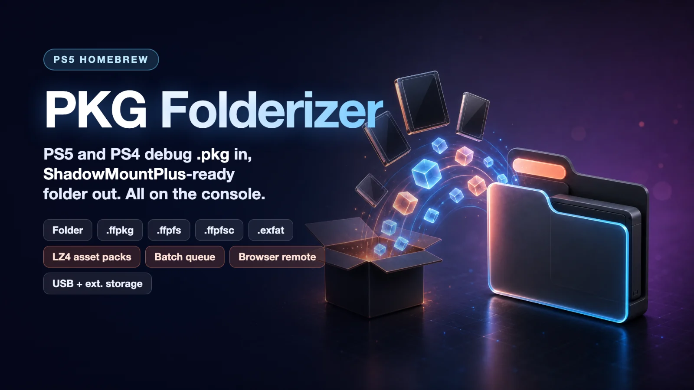
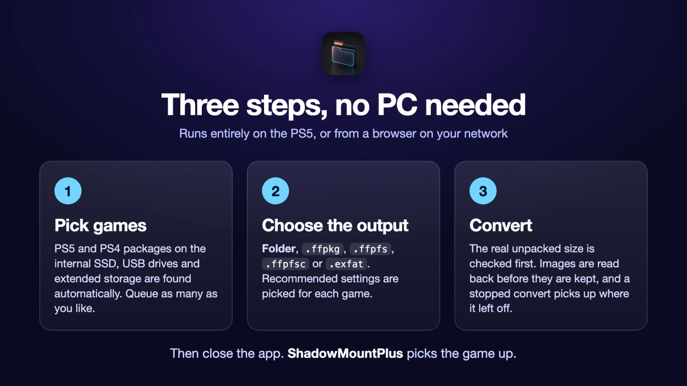
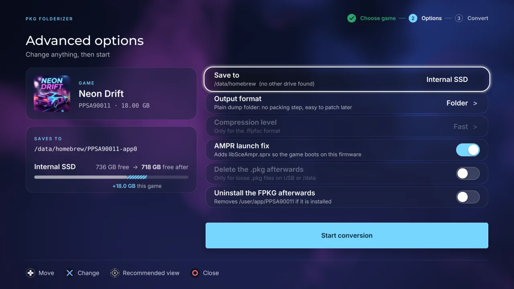
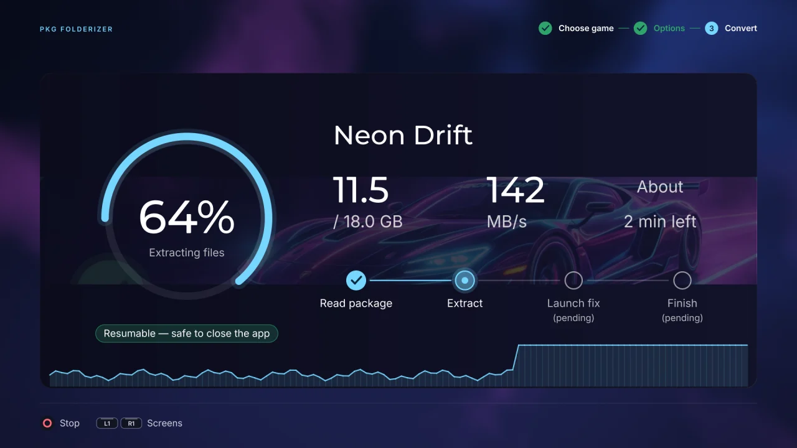
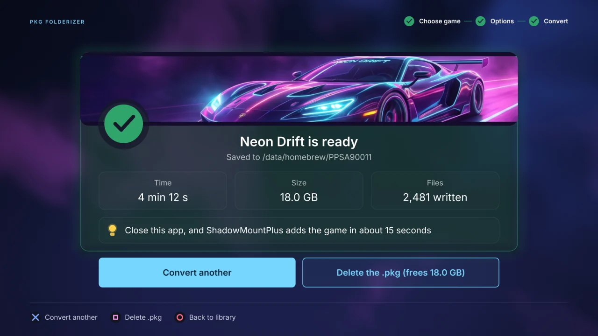

  

# PKG Folderizer for PS5

Converts PS5 and PS4 debug (FPKG) `.pkg` files into folders and images that **ShadowMountPlus** can run,
directly on the console. Built for homebrew developers and for backups of games you own.

Download it from [desstannsoftware.com](https://desstannsoftware.com/#pkg-folderizer).

  

## Features

- **PS5 and PS4 packages.** Debug packages on the internal SSD, USB drives and extended storage are found
  automatically, along with games that are already installed. The list shows each one's format: PS5 FPKG,
  PS4 PKG or Folder.
- **Game images as sources.** `.exfat`, `.ffpkg`, `.ffpfs` and `.ffpfsc` files are found in the same
  places as packages and convert to any output format.
- **Every ShadowMount format.** Write a plain **Folder** (the default) or a single image: `.ffpkg` (UFS2),
  `.ffpfs` (PFS), `.ffpfsc` (compressed PFS, with fast, balanced or smallest compression) or `.exfat`.
- **LZ4 asset packs.** Game data can be packed into the LZ4 volumes the AMPR emulator reads, for games
  that need them.
- **AMPR launch fix.** Adds `libSceAmpr.sprx` so the game boots on this firmware, and replaces an older
  official build the game already ships with.
- **Recommended settings.** The format and options that suit each game are picked for you. Everything can
  still be changed under Advanced options.
- **Batch queue.** Queue several games and convert them one after another, each with its own recommended
  settings. The PS5 can power off when the queue is done.
- **Browser remote.** Open the address shown in the app from a phone or computer on the same network to
  browse your games, start and queue conversions and follow their progress.
- **Accurate space check.** The real unpacked size is read from the package before anything is written,
  and the screen shows how much space is left once the convert is done.
- **Safe output.** Every image is read back and checked before it is kept, and the source package is only
  deleted after that check passes.
- **Resume.** A convert that stops partway, because the app closed or the drive filled up, continues
  where it stopped the next time you start the same package.
- **Fast.** Packages are decompressed and written on four threads.
- **Homebrew store.** Install and update our other apps, PKG Folderizer included, from the browser remote.

## Screens

  
  

  

## You need

- A PS5 running **kstuff** and an ELF loader (port `9021`)
- **ShadowMountPlus**

## Install

1. Extract `PPSA99180.zip` and copy the `PPSA99180` folder to `/data/homebrew/`.
   Or put `PPSA99180.ffpkg` where ShadowMountPlus looks for images.
2. **PKG Folderizer** appears on the home screen.

You can also get it from the Homebrew Store.

## Use

1. Pick a game, or queue several.
2. Check the recommended output, or open Advanced options to choose the drive, format and compression.
3. Start. When it finishes, close the app and ShadowMountPlus picks up the game.

## Community

Questions and bug reports: [Desstann Homebrew Discord](https://discord.gg/4kWZzQk9MV)

## Legal

PKG Folderizer contains no games, keys or other copyrighted content from Sony or any publisher, and it does
not download any. Use it only with homebrew and with packages you have the right to use.

## License

Copyright (C) 2026 Desstann. [All Rights Reserved](LICENSE).
